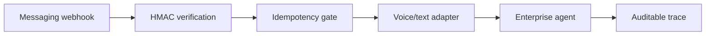

# Agentforce Voice Channel Reference

> A secure, provider-neutral webhook adapter for delivering text and synthetic voice transcripts to an enterprise agent.



## Quickstart

```bash
make test
make eval
make demo
```

## What I built

- Constant-time webhook signature verification.
- Duplicate-message protection.
- Separate text and voice paths.
- Fail-closed handling for invalid or empty input.
- Ten scenarios across 30 trials.

## What is mocked

The channel, speech transcript, and downstream agent are deterministic local adapters. No provider account is required and no real message or audio is stored.

## Known limitations

The reference does not include media transcoding, provider-specific deployment, or a production agent runtime.

See [SECURITY.md](SECURITY.md) and [PROVENANCE.md](PROVENANCE.md).
